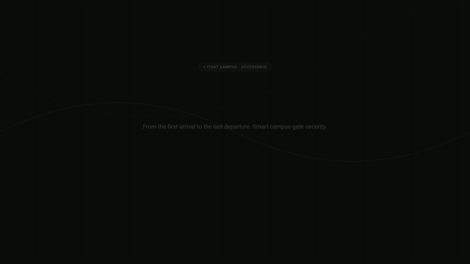
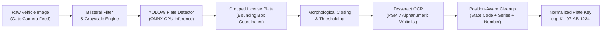
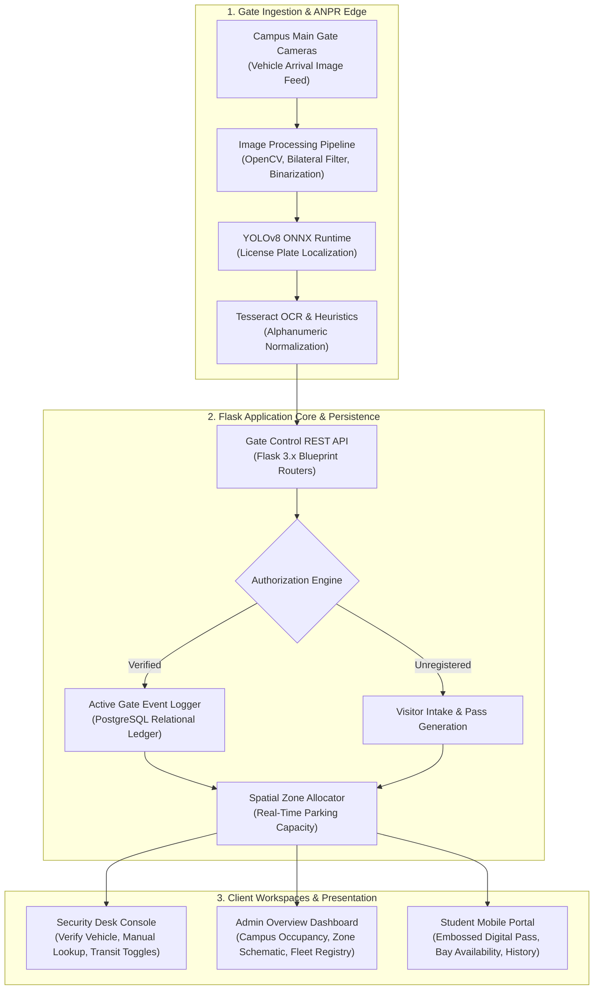
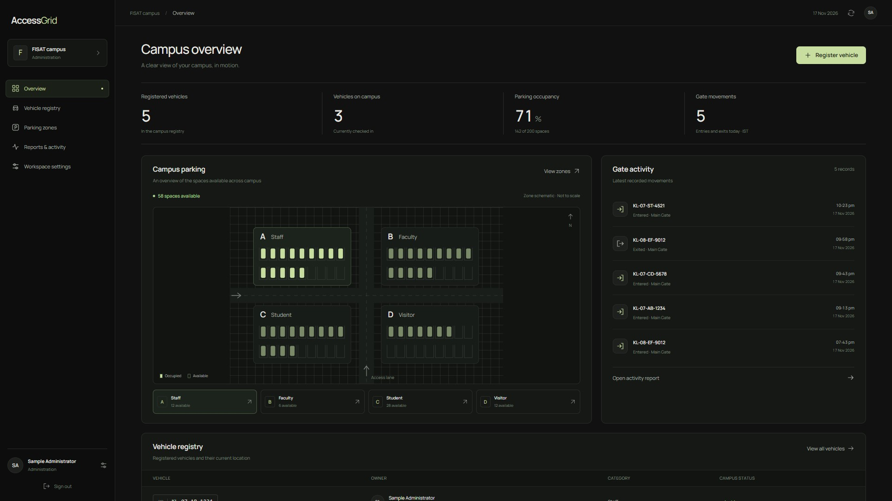
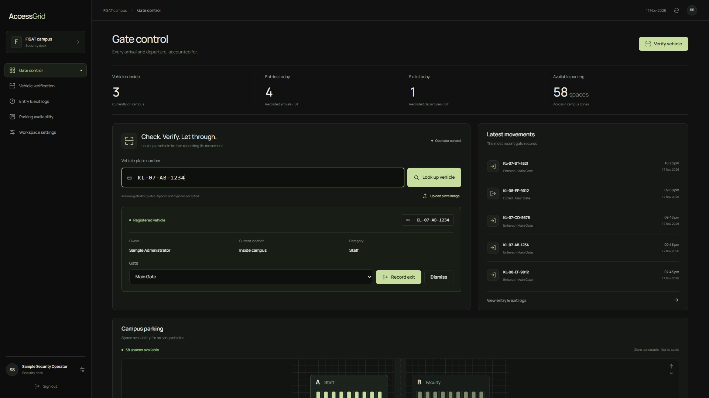
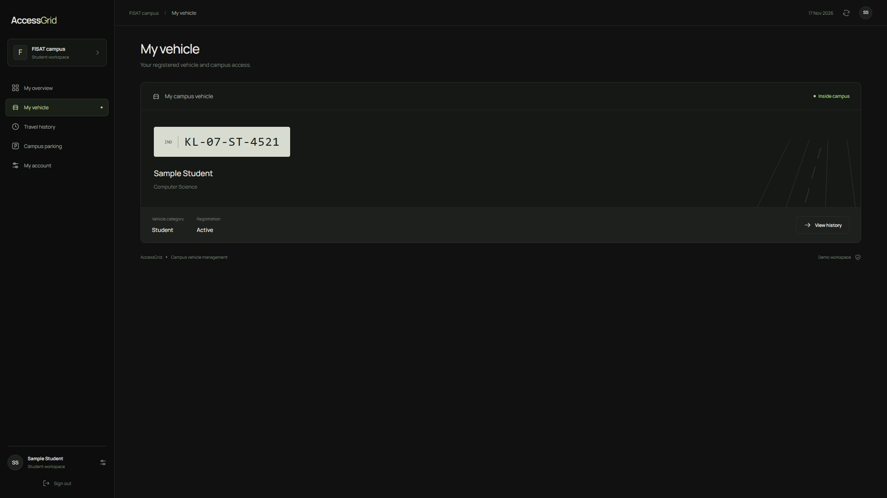
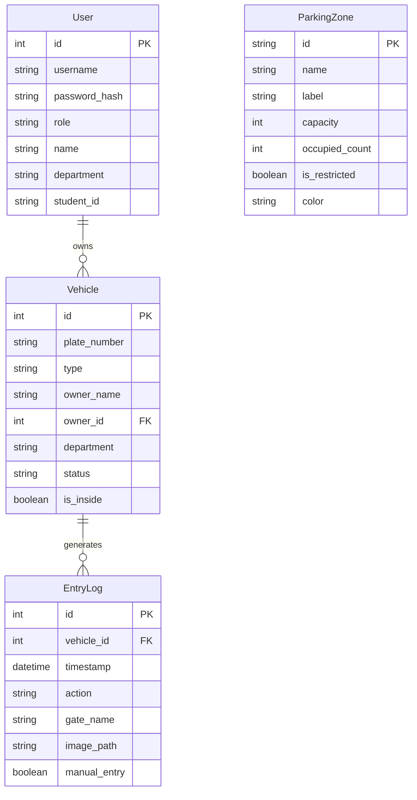

<div align="center">

# 🚗 AccessGrid

### Intelligent Campus Vehicle Entry-Exit Management & ANPR Telemetry Platform

[](https://access-grid.vercel.app/)

[](https://react.dev/)
[](https://vitejs.dev/)
[](https://flask.palletsprojects.com/)
[](https://www.postgresql.org/)
[](https://ultralytics.com/)
[](https://github.com/tesseract-ocr/tesseract)
[](LICENSE)
[](https://github.com/reignofoptimus/AccessGrid/stargazers)
[](https://github.com/reignofoptimus/AccessGrid/network/members)
[](https://github.com/reignofoptimus/AccessGrid/commits/main)

<br>

<a href="https://access-grid.vercel.app/">
  
</a>

<p align="center">
  <em>High-precision campus vehicle access, edge license plate recognition, real-time gate pass verification, and spatial parking zone telemetry.</em>
</p>

<p align="center">
  <a href="https://access-grid.vercel.app/"><strong>🚀 Launch Live Application</strong></a>
  &nbsp;&nbsp;•&nbsp;&nbsp;
  <a href="#quick-start"><strong>⚡ Quick Start</strong></a>
</p>

</div>

---

## 📑 Table of Contents

- [✨ Overview](#overview)
- [⚡ Key Capabilities](#key-capabilities)
- [🧠 ANPR Intelligence Pipeline](#anpr-intelligence-pipeline)
- [🏗️ System Architecture](#system-architecture)
- [🛠️ Tech Stack](#tech-stack)
- [📸 Application Walkthrough](#application-walkthrough)
- [🚀 Quick Start](#quick-start)
- [🔐 Demo Credentials](#demo-credentials)
- [📡 API Endpoints](#api-endpoints)
- [📊 Database Schema](#database-schema)
- [📁 Repository Structure](#repository-structure)
- [🤝 Contributing](#contributing)
- [📄 License](#license)

---

## ✨ Overview

**AccessGrid** is an intelligent campus security and transit operations platform engineered to replace paper gate registers and manual parking logs with automated, real-time vehicle access control. Combining edge-optimized **Automatic Number Plate Recognition (ANPR)** via YOLOv8 and Tesseract OCR with role-segregated operator dashboards, AccessGrid verifies arrivals in milliseconds, tracks campus occupancy across designated zones, and maintains an immutable audit trail of every gate transit.

> [!NOTE]  
> **Tactile Security Desk Posture:** AccessGrid functions as a high-precision operating instrument for campus gatekeepers. Automated detections are paired with instant operator overrides, manual plate lookups, and one-click entry/exit recordings.

---

## ⚡ Key Capabilities

| Capability | Core Functionality | Underlying Engine | Operator Benefit |
|---|---|---|---|
| **Edge ANPR Detection** | Automated plate extraction from gate camera images | Custom-trained YOLOv8 (ONNX Runtime CPU) + Tesseract OCR | Sub-second plate reading without dedicated GPU hardware |
| **Indian Plate Normalization** | Heuristic character disambiguation (`KA01AB1234` / `KL07AB1234`) | Position-aware regex parser & optical character correction | Eliminates common OCR ambiguities (e.g. `0` vs `O`, `1` vs `I`) |
| **Instant Gate Verification** | Operator search console matching incoming plates against registry | Indexed SQL lookup across registered students, faculty, & staff | Instant owner clearance, department identification, and pass status |
| **Spatial Parking Telemetry** | Interactive vector schematic displaying live bay availability | Vector SVG campus map with dynamic occupancy counters | Real-time zone capacity monitoring (Staff, Faculty, Student, Visitor) |
| **Digital Vehicle Passes** | Mobile-ready digital credentials for students & staff members | High-contrast embossed plate UI with live gate status tags | Instant pass presentation with complete personal travel history |
| **Role-Based Access Control** | Dedicated interfaces tailored for Admins, Security, and Students | Cookie-based session authentication with Werkzeug encryption | Least-privilege separation of registry, gate control, and telemetry |
| **Continuous Audit Log** | Immutable historical record of all gate transit timestamps | Relational event schema tracking timestamp, gate, and method | Instant search, filter, and audit review for campus security teams |

---

## 🧠 ANPR Intelligence Pipeline



### Optical Pipeline Stages
1. **Edge Detection:** Gate camera captures incoming vehicle; custom-trained YOLOv8 model localizes the plate boundary box.
2. **Image Preprocessing:** Cropped plate region undergoes 4× scaling, bilateral noise filtration, adaptive binarization, and morphological cleanup.
3. **OCR Extraction:** Tesseract OCR (configured with Page Segmentation Mode 7) extracts raw alphanumeric characters.
4. **Deterministic Normalization:** Post-processing heuristics parse the string against standard Indian regional registration formats (`[State: 2 chars] [District: 2 digits] [Series: 1-2 chars] [Number: 4 digits]`), resolving optical character ambiguities before querying the database.

---

## 🏗️ System Architecture



---

## 🛠️ Tech Stack

<div align="center">

| Layer | Badges | Technologies |
|---|---|---|
| **Frontend** | [](https://react.dev/) [](https://vitejs.dev/) [](https://tailwindcss.com/) [](https://axios-http.com/) | React 19, Vite 7, Tailwind CSS, Lucide Icons, Axios, Vite PWA |
| **Backend** | [](https://python.org) [](https://flask.palletsprojects.com/) [](https://www.sqlalchemy.org/) [](https://gunicorn.org/) | Python 3.10+, Flask 3.x, Flask-SQLAlchemy, Flask-Login, Gunicorn |
| **Computer Vision & ML** | [](https://ultralytics.com/) [](https://onnxruntime.ai/) [](https://opencv.org/) [](https://github.com/tesseract-ocr/tesseract) | Custom YOLOv8 Plate Detector, ONNX Runtime CPU, OpenCV, Tesseract OCR 5.x |
| **Database & Cloud** | [](https://www.postgresql.org/) [](https://vercel.com/) [](https://render.com/) | PostgreSQL 16 (Neon / Render / Supabase compatible), Vercel Hosting |
| **Security & Auth** | [](https://flask-login.readthedocs.io/) [](https://palletsprojects.com/p/werkzeug/) | HTTP-Only Secure Cookies, Werkzeug Password Hashing, CSRF Protection |

</div>

---

## 📸 Application Walkthrough

| Module | Interface Preview | Description |
|---|---|---|
| **Campus Overview & Analytics** |  | Real-time vehicle surveillance, 71% live occupancy telemetry, interactive glowing parking zone schematic, and recent gate movements |
| **Security Gate Control** |  | Instant license plate lookup (`KL-07-AB-1234`), credential verification (*Staff · Inside Campus*), and one-click entry/exit gate recording |
| **Digital Vehicle Pass** |  | Student and faculty digital credential cards featuring high-contrast embossed registration plates (`IND KL-07-ST-4521`) and travel history |

---

## 🚀 Quick Start

### 1. Fast Launch (Windows)

Launch the complete stack (both Flask backend and React frontend) with one command:

```powershell
.\start.bat
```

* **Frontend Application:** `http://localhost:5173`
* **Backend REST API:** `http://localhost:5000`

---

<details>
<summary><strong>🔧 Manual Installation & Step-by-Step Setup (Click to expand)</strong></summary>

<br>

#### Step 1: Clone the Repository
```bash
git clone https://github.com/reignofoptimus/AccessGrid.git
cd AccessGrid
```

#### Step 2: Configure & Start Backend
```bash
cd backend
python -m venv venv

# Windows
.\venv\Scripts\activate

# Linux/macOS
source venv/bin/activate

pip install -r requirements.txt
python seed.py
python run.py
```

#### Step 3: Configure & Start Frontend
Open a new terminal window:
```bash
cd frontend
npm install
npm run dev
```

</details>

---

## 🔐 Demo Credentials

The platform includes pre-configured demo profiles for all campus operational roles:

| Role | Username | Password | Operational Access |
|---|---|---|---|
| **Campus Administrator** | `admin` | `admin123` | Campus Analytics, Zone Capacity, Vehicle Registry, Global Logs |
| **Security Gate Operator** | `security` | `security123` | Security Gate Desk, Instant Plate Scanner, Real-Time Entry/Exit Controls |
| **Registered Student** | `student` | `student123` | Personal Vehicle Status, Embossed Pass, Campus Parking Wayfinding |

> [!TIP]  
> All three role accounts can be tested instantly with **one click** directly from the [live demo login page](https://access-grid.vercel.app/).

---

## 📡 API Endpoints

| Method | Endpoint | Description | Access Level |
|---|---|---|---|
| `POST` | `/api/auth/login` | Authenticate user and issue secure session cookie | Public |
| `GET` | `/api/auth/me` | Retrieve authenticated profile and operational permissions | Authenticated |
| `POST` | `/api/auth/logout` | Terminate session and invalidate auth cookies | Authenticated |
| `GET` | `/api/vehicles/` | Query campus vehicle registry with filter parameters | Admin / Security |
| `POST` | `/api/vehicles/` | Register new student, faculty, or visitor vehicle | Admin |
| `POST` | `/api/gate/entry` | Record vehicle arrival timestamp and assign zone bay | Security |
| `POST` | `/api/gate/exit` | Record vehicle departure timestamp and free zone bay | Security |
| `GET` | `/api/gate/logs` | Fetch chronologically sorted campus gate movement logs | Admin / Security |
| `GET` | `/api/parking/zones` | Retrieve real-time zone capacities and occupancy numbers | All Users |
| `GET` | `/api/stats/` | Aggregate campus transit KPIs and headcounts | Admin |
| `POST` | `/api/anpr/detect` | Execute YOLOv8 detection and Tesseract OCR on uploaded image | Security |

---

## 📊 Database Schema



---

## 📁 Repository Structure

```
AccessGrid/
├── assets/                       # High-definition demonstration assets and UI previews
│   ├── demo.gif                  # Autoplaying product walkthrough
│   ├── demo.mp4                  # Full HD 1080p demonstration video
│   ├── campus-overview.jpg       # Executive campus overview interface
│   ├── gate-control.jpg          # Security gate control & plate lookup interface
│   └── vehicle-pass.jpg          # Student embossed digital vehicle pass interface
├── anpr/                         # Standalone ANPR training pipeline
│   ├── anpr_pipeline.py          # Python detection & OCR pipeline script
│   ├── dataset/                  # License plate training & validation images
│   └── runs/                     # YOLOv8 training weights (best.pt)
├── backend/                      # Flask REST API & computer vision service
│   ├── app/
│   │   ├── routes/               # API route blueprints (auth, gate, vehicles, parking...)
│   │   ├── anpr/                 # Production ONNX runtime detector & OCR pipeline
│   │   ├── models.py             # SQLAlchemy relational database models
│   │   └── utils/                # Helper utilities and input sanitizers
│   ├── seed.py                   # Pre-seeded campus database generator
│   ├── config.py                 # Application configuration & secret keys
│   └── run.py                    # Server bootstrapper
├── frontend/                     # React 19 + Vite client application
│   ├── src/
│   │   ├── components/           # UI modules (Overview, GateControl, VehicleRegistry...)
│   │   ├── api/                  # Axios typed API client
│   │   └── App.tsx               # Master router & role gatekeeper
│   ├── tailwind.config.js        # Design tokens & tactile color palette
│   └── package.json              # Node.js dependencies & scripts
├── setup.bat                     # One-click environment configuration
├── start.bat                     # Dual-stack automated launcher
├── LICENSE                       # MIT Open Source License
└── README.md                     # Comprehensive technical documentation
```

---

## 🤝 Contributing

Contributions are welcome from developers, computer vision researchers, and campus security engineers!

1. **Fork the Repository**
2. **Create a Feature Branch:** `git checkout -b feature/enhanced-plate-heuristics`
3. **Commit Your Changes:** `git commit -m "feat: add confidence threshold tuning for low-light ANPR"`
4. **Push to the Branch:** `git push origin feature/enhanced-plate-heuristics`
5. **Open a Pull Request:** Describe the enhancements and ensure existing tests pass.

---

## 📄 License

Distributed under the **MIT License**. See [`LICENSE`](LICENSE) for more information.

<div align="center">
  <sub>Engineered by <a href="https://github.com/reignofoptimus">Nirmal Madhu</a> · Intelligent campus transit & access automation</sub>
</div>
